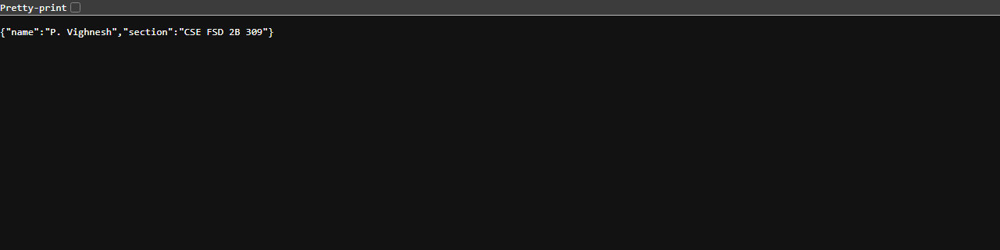
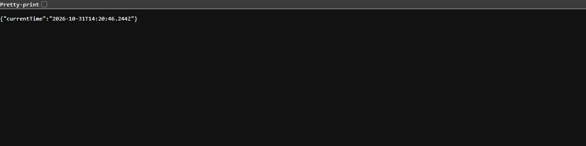

# Lab 1: Node.js and Express server

**P. Vighnesh** · Registration number **252U1R7075** · Section **CSE FSD 2B 309**

**Live link:** https://bdf-lab-01-vighnesh.vercel.app/

Course: Backend Development Fundamentals — Year II Term II — Aurora
Faculty: Joel Prashanth D

## Objective

Set up a Node.js project and build a small web server twice: first with the built-in `http` module, then with Express. The Express version exposes three routes and returns a 404 message for any unknown path.

## Technologies used

- Node.js (v18 or later)
- Express.js 4
- JavaScript
- npm
- Visual Studio Code

## Project structure

```text
lab-01/
├── api/
│   └── index.js           # Vercel entry point (imports the Express app)
├── screenshots/
│   ├── home.png
│   ├── about.png
│   ├── time.png
│   └── not-found.png
├── .gitignore
├── package.json
├── package-lock.json
├── server-http.js         # Built-in http module server
├── server.js              # Express server
├── vercel.json            # Routes all requests to api/index.js
└── README.md
```

## How to run

### Prerequisites

- Node.js installed (`node --version`)
- npm installed (`npm --version`)

### Install and start

Open a terminal in this `lab-01` folder and install the dependencies:

```bash
npm install
```

Start the Express server:

```bash
npm start
```

Then open `http://localhost:3000` in a browser.

To run the plain `http` module version instead:

```bash
npm run http
```

Stop a running server with `Ctrl + C` before starting the other one, because both use the same port.

### Environment variables

| Variable | Required | Description |
|---|---|---|
| `PORT` | No | Port the server listens on. Falls back to `3000` when it is not set. |

No other environment variables or secrets are used in this lab, so there is no `.env` file to create. Nothing sensitive is committed to the repository.

## Endpoints

| Method | Path | Description | Status |
|---|---|---|---|
| GET | `/` | Returns the welcome text. | 200 OK |
| GET | `/about` | Returns my name and section as JSON. | 200 OK |
| GET | `/time` | Returns the current date and time as JSON, generated with `new Date()`. | 200 OK |
| GET | `/anything-else` | Any unknown path returns `404 - Page not found`. | 404 Not Found |

The plain `http` server in `server-http.js` answers every request with `Hello` and status `200`.

Status codes were checked for every route in the browser and from the terminal:

```text
GET /                     -> 200
GET /about                -> 200
GET /time                 -> 200
GET /unknown-route        -> 404
```

## Screenshots

### 1. Home route — `GET /`

Returns the welcome message with status 200.


### 2. About route — `GET /about`

Returns name and section as JSON with status 200.



### 3. Time route — `GET /time`

Returns the current date and time from `new Date()` with status 200.



### 4. Unknown route — 404

Any path that is not defined returns the 404 message.


## Notes: problems faced and how I solved them

**Port already in use (`EADDRINUSE`).** `server.js` and `server-http.js` both listen on port 3000, so starting the second one while the first is still running crashed with `EADDRINUSE`. I stopped the running server with `Ctrl + C` before starting the other file.

**Hardcoded port broke the deployment.** The first version used `const PORT = 3000`. On a hosting platform the port is provided by the environment, so the server never became reachable. I changed it to `process.env.PORT || 3000`, which keeps 3000 locally and uses the platform's port when deployed.

**Vercel needed the app exported.** A server that only calls `app.listen()` does not work as a serverless function. I moved the `listen` call behind `if (require.main === module)`, exported the app with `module.exports = app`, and added `api/index.js` plus `vercel.json` so every request is forwarded to the Express app. The same `server.js` still runs normally with `npm start`.

**Screenshot filenames with spaces.** File names such as `Screenshot 2026-10-16 094720.png` broke the image links in Markdown. I renamed every file to a single lowercase word without spaces (`home.png`, `about.png`, `time.png`, `not-found.png`) and linked them with ``.

## Viva preparation

**1. What is the difference between `package.json` and `node_modules`?**
`package.json` is a small text file that describes the project and lists its dependencies, scripts and metadata. `node_modules` is the folder where `npm install` downloads the actual code of those dependencies. `package.json` is committed to Git, `node_modules` is not.

**2. What does `app.listen` do?**
It tells the Express application to start an HTTP server and listen for incoming requests on the given port and host. The callback runs once the server is ready.

**3. What do `request` and `response` represent?**
`request` is the incoming HTTP request from the client: URL, method, headers, query string and body. `response` is the object used to send data back: status code, headers and the response body.

## Rules followed

- `node_modules` is not committed; it is excluded by `.gitignore`.
- No `.env` file or secret values are committed.
- Every route returns the correct status code (200 for successful routes, 404 for unknown paths).
- The repository is public.
