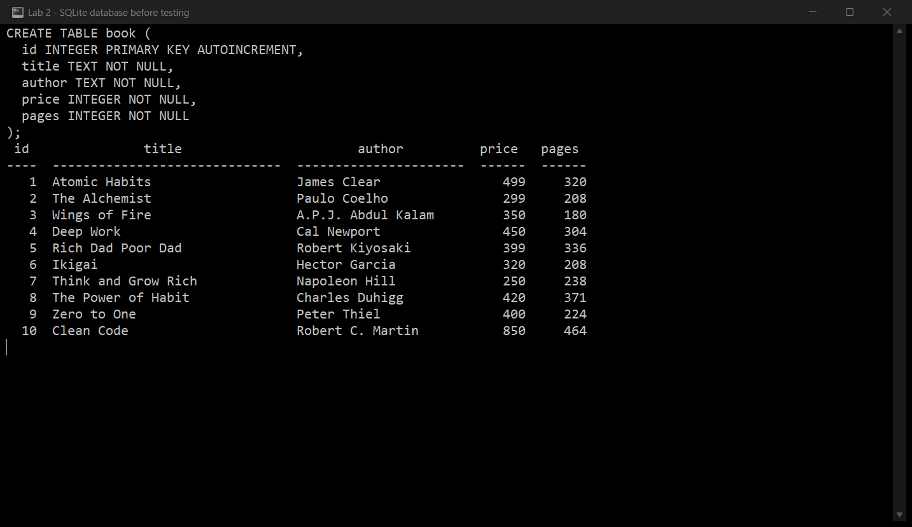
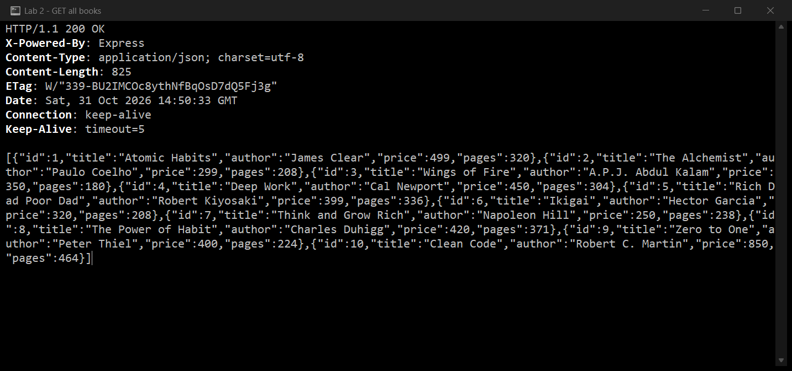
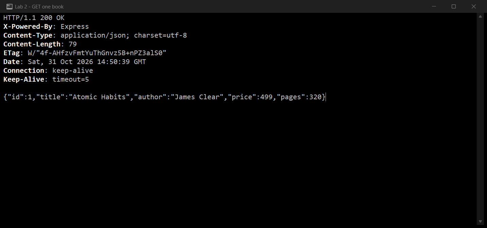
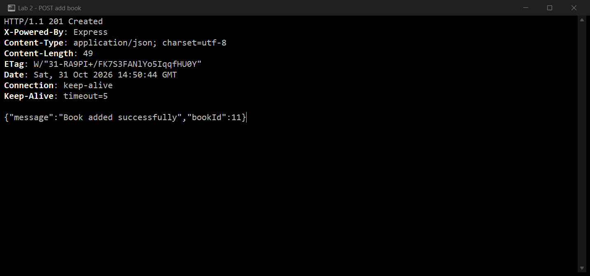
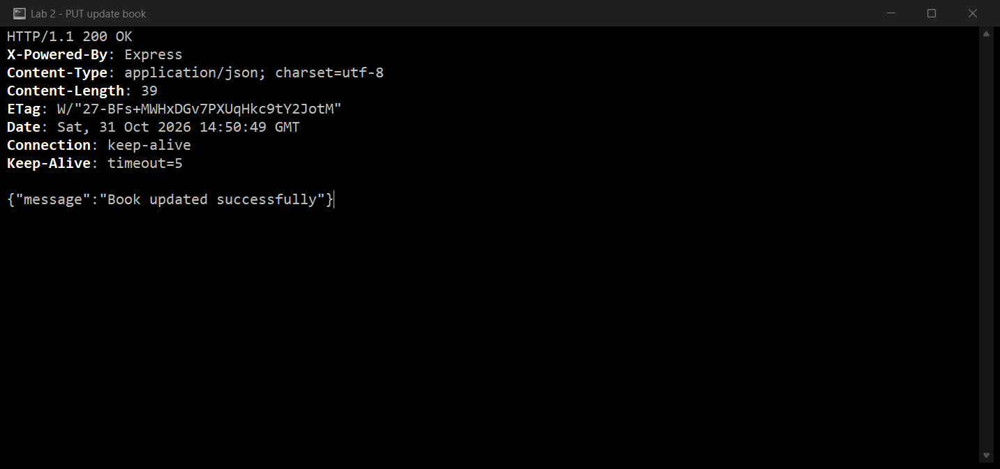
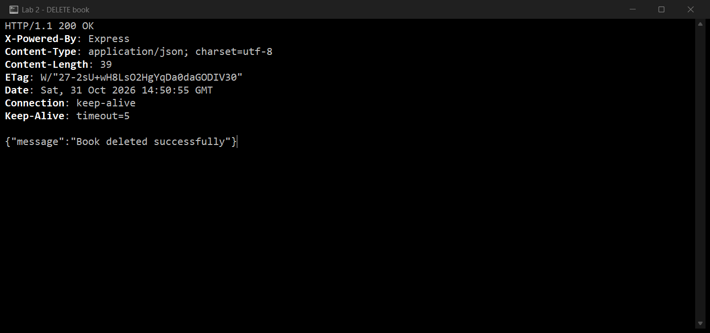
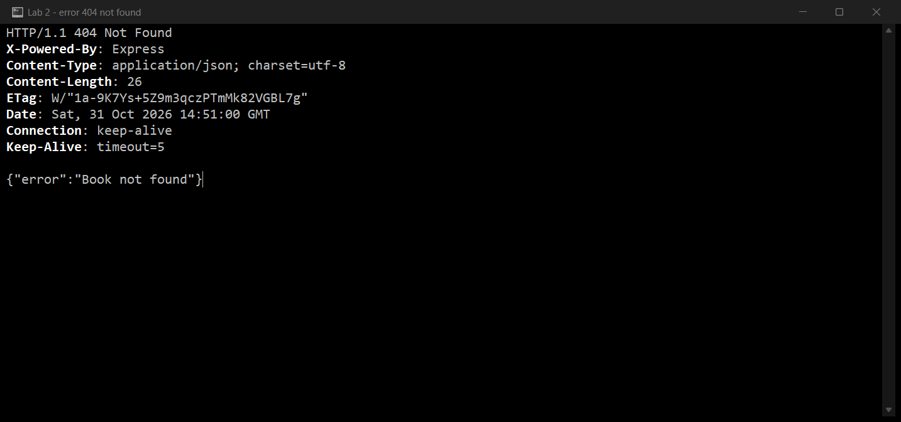
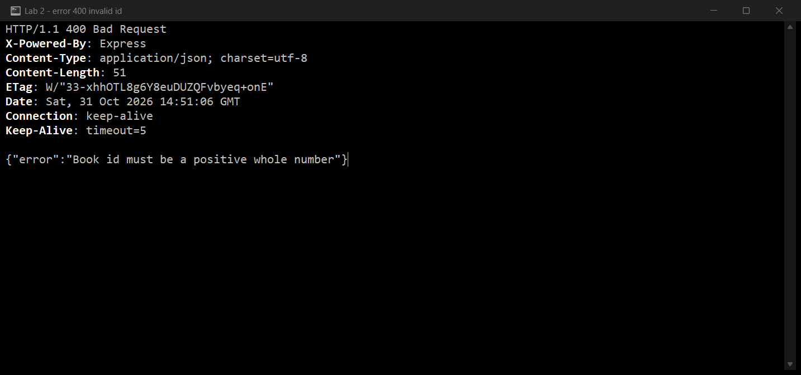
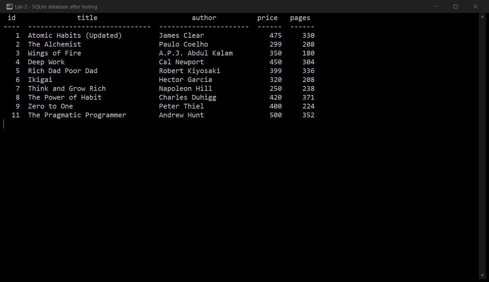

# Lab 2: SQLite database and CRUD routes

**P. Vighnesh** · Registration number **252U1R7075** · Section **CSE FSD 2B 309**

**Live link:** https://bdf-lab-02-vighnesh.vercel.app/

Course: Backend Development Fundamentals — Year II Term II — Aurora
Faculty: Joel Prashanth D

> The live server stores its database in `/tmp`, which is the only writable folder on Vercel. Adding, updating or deleting a book through the live link works, but the data goes back to the 10 starting rows when the server restarts. The local version keeps its changes in `books.db`.

## Objective

Connect an Express server to a SQLite database and expose create, read, update and delete operations over HTTP, so the `book` table changes after POST, PUT and DELETE.

## Technologies used

- Node.js (v18 or later)
- Express.js 4
- SQLite (`sqlite` and `sqlite3` packages)
- nodemon (development only)
- SQLite command-line shell
- Visual Studio Code

## Project structure

```text
lab-02/
├── api/
│   └── index.js           # Vercel entry point (imports the Express app)
├── screenshots/
│   ├── db-before.png
│   ├── get-all.png
│   ├── get-one.png
│   ├── post.png
│   ├── put.png
│   ├── delete.png
│   ├── error-400.png
│   ├── error-404.png
│   └── db-after.png
├── .gitignore
├── books.db               # SQLite database file (10 starting rows)
├── init.sql               # Table definition and the 10 rows
├── seed.js                # Rebuilds books.db from init.sql
├── package.json
├── package-lock.json
├── server.js              # Express server with the CRUD routes
├── vercel.json            # Sends all requests to api/index.js
└── README.md
```

## How to run

### Prerequisites

- Node.js and npm installed (`node --version`, `npm --version`)
- The SQLite CLI is only needed if you want to create the database by hand

### Install and start

Open a terminal in this `lab-02` folder:

```bash
npm install
npm run dev
```

`npm run dev` starts the server with nodemon, so it restarts automatically on every change. The terminal prints:

```text
Server running on port 3000
```

Open `http://localhost:3000/books/` in the browser. Use `npm start` instead of `npm run dev` to run it with plain Node.

### Database

The database file `books.db` is committed, so the project works as soon as it is cloned. To rebuild it from scratch:

```bash
sqlite3 books.db < init.sql
```

or, without the SQLite CLI installed:

```bash
npm run seed
npm run seed -- --reset     # drops the table and re-inserts the 10 rows
```

To inspect the table:

```bash
sqlite3 books.db
.headers on
.mode column
SELECT * FROM book;
```

### Environment variables

| Variable | Required | Description |
|---|---|---|
| `PORT` | No | Port the server listens on. Falls back to `3000` when it is not set. |

No database password, API key or `.env` file is used in this lab, so there is nothing to keep secret. `.env` files are ignored by `.gitignore` in case they are added later.

## Endpoints

| Method | Path | Description | Success |
|---|---|---|---|
| GET | `/books/` | Returns every book in the table. | 200 |
| GET | `/books/:bookId/` | Returns the book with that id. | 200 |
| POST | `/books/` | Adds a book from the JSON body. | 201 |
| PUT | `/books/:bookId/` | Replaces the details of an existing book. | 200 |
| DELETE | `/books/:bookId/` | Deletes the book with that id. | 200 |

Request body for POST and PUT:

```json
{
  "title": "The Pragmatic Programmer",
  "author": "Andrew Hunt",
  "price": 500,
  "pages": 352
}
```

Error responses:

| Case | Status |
|---|---|
| `bookId` is not a positive whole number | 400 |
| A required field is missing or has the wrong type | 400 |
| The request body is not valid JSON | 400 |
| No book exists with that id | 404 |
| Unknown route | 404 |

Every query that uses input from the request uses `?` placeholders, for example:

```js
await db.get("SELECT * FROM book WHERE id = ?;", [bookId]);
```

## Testing

Each route was called against the running server and the response was compared with the SQLite CLI. The screenshots below show the raw HTTP response, including the status line, and the terminal screenshots of `sqlite3` show the table before and after the changes.

| Route | Status observed | Database effect |
|---|---|---|
| `GET /books/` | 200 | none |
| `GET /books/1/` | 200 | none |
| `POST /books/` | 201 | new row added, id 11 |
| `PUT /books/1/` | 200 | row 1 updated |
| `DELETE /books/10/` | 200 | row 10 removed |
| `GET /books/999/` | 404 | none |
| `GET /books/abc/` | 400 | none |

## Screenshots

### Database before testing

The `book` table and its 10 starting rows, read with the SQLite CLI.



### GET /books/ — all books

Returns every row with status 200.



### GET /books/1/ — one book

Returns the single book with id 1 and status 200.



### POST /books/ — add a book

Adds a book and returns status 201 with the new id.



### PUT /books/1/ — update a book

Updates the fields of book 1 and returns status 200.



### DELETE /books/10/ — delete a book

Deletes book 10 and returns status 200.



### Error case — unknown book id

`GET /books/999/` returns 404 because no such row exists.



### Error case — invalid book id

`GET /books/abc/` returns 400 because the id is not a positive whole number.



### Database after testing

Row 1 is updated, row 10 is gone and the book added with POST has id 11.



## Notes: problems faced and how I solved them

**The SQLite CLI was not on the PATH.** Running `sqlite3` in the terminal failed, so I downloaded the official command-line tools from sqlite.org, ran `sqlite3 books.db < init.sql` to create the table, and later added `seed.js` so the database can be rebuilt with only Node installed.

**`database is locked` while re-seeding.** The database file could not be deleted or replaced while the server was still running, because SQLite had it open. I stopped the server with `Ctrl + C` before running the CREATE/INSERT script again.

**An invalid id returned 404 instead of 400.** The first version of `GET /books/:bookId/` sent `abc` straight to SQLite, which found no row and answered 404. That hides a bad request behind a "not found", so I added an `isValidId()` check that answers 400 before touching the database.

**Malformed JSON produced an HTML error page.** When the POST body was not valid JSON, Express returned an HTML stack trace instead of JSON like every other response. I added an error-handling middleware that turns a body-parser error into `400 {"error": "Request body must be valid JSON"}`.

**The filesystem is read-only on the hosting platform.** `CREATE TABLE` and `INSERT` failed on the live link because the deployment folder cannot be written to. The server now copies `books.db` into `/tmp` when it is deployed and writes there, which is why the live database returns to its starting rows after a restart.

## Viva preparation

**1. Why `await` the database call?**
`db.all()`, `db.get()` and `db.run()` return a promise. The data or the result of the write is only available after that promise settles, so `await` pauses the handler until SQLite answers. Without it, `books` would still be a pending promise and the response would be sent before the query finished.

**2. What is SQL injection, and how do placeholders prevent it?**
SQL injection is when user input is glued into the SQL string, so the input is treated as SQL code. A value such as `1; DROP TABLE book;` would become part of the statement. With `?` placeholders the query text is sent to SQLite separately from the values, so the input is always treated as data and can never change the statement.

**3. When is PUT used instead of POST?**
POST creates a new resource and does not need an id, and it answers 201. PUT replaces an existing resource at a known URL, is idempotent (sending the same body twice leaves the same result) and answers 200. Here POST adds a book, PUT updates `/books/:bookId/`.
